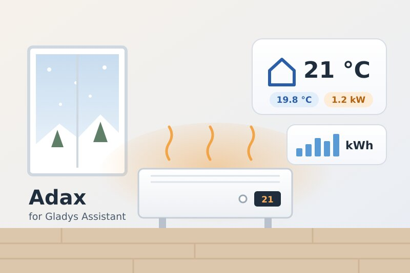
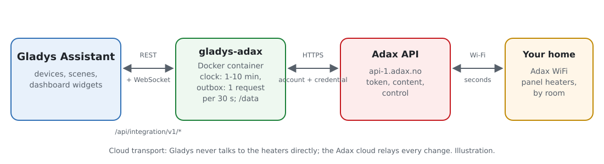
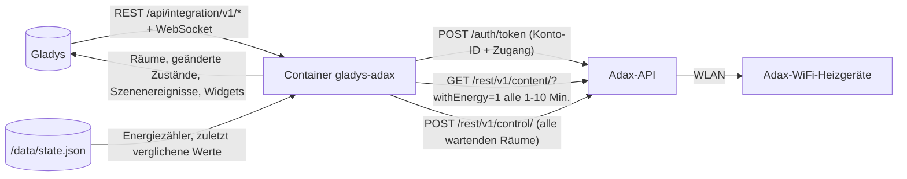
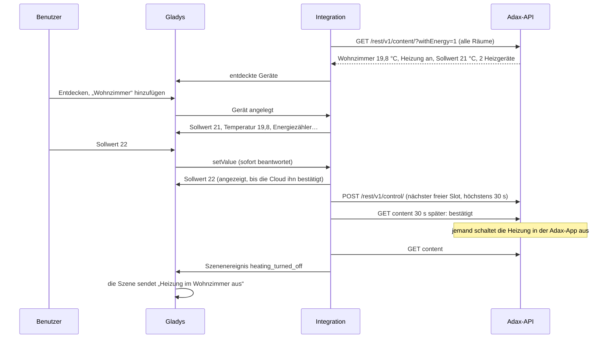
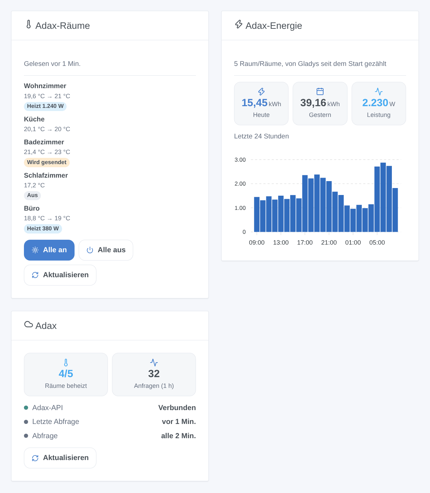

# Gladys Adax

[English](README.md) · [Français](README.fr.md) · **Deutsch** · [Español](README.es.md)

[](LICENSE)
[](https://github.com/William-De71/gladys-adax/releases)
[](https://github.com/William-De71/gladys-adax/actions/workflows/release.yml)
[](https://gladysassistant.com)



Externe Integration für [Gladys Assistant](https://gladysassistant.com) für **Adax-WiFi**-Heizgeräte: ein Gerät pro Raum mit Sollwert, Heizung an / aus, Temperatur, Leistung und Energiezähler. Sie nutzt die offizielle Adax-API mit einem Zugang aus der Adax-WiFi-App und bringt Szenenauslöser und -aktionen sowie Widgets für die Räume und die Energie der letzten 24 Stunden mit.

Benutzerdokumentation: [English](docs/en.md) · [Français](docs/fr.md) · [Deutsch](docs/de.md) · [Español](docs/es.md).

Nicht mit Adax verbunden. **Noch nicht mit einem echten Adax-Konto getestet**: Die Anfragen folgen der offiziellen Dokumentation und dem OpenAPI-Dokument der Adax-API sowie dem Takt von [pyAdax](https://github.com/Danielhiversen/pyAdax), der Bibliothek der Home-Assistant-Komponente.

## Funktionen

- **Ein Gerät pro Raum** der Adax-App (die API steuert Räume, keine einzelnen Heizgeräte): Sollwert (5 bis 35 °C in ganzen Grad), Heizung an / aus, Raumtemperatur und, wenn die Heizgeräte ihre Energie melden, aktuelles Heizen, mittlere Leistung und ein **Energiezähler** für das Energie-Dashboard von Gladys.
- Alle Räume mit **einer Anfrage** alle 1, 2, 5 oder 10 Minuten gelesen; Befehle sofort angezeigt und in **einer Steueranfrage** gebündelt, innerhalb von 30 Sekunden (Adax akzeptiert eine Anfrage alle 30 Sekunden).
- **3 Szenenauslöser**, **3 Szenenaktionen** und **3 Dashboard-Widgets** (unten), eine Schaltfläche **Verbindung testen**.
- Die Drosselung von Adax wird berücksichtigt: Ein 402 „Request limit exceeded“ verlangsamt die Abfragen, statt zu drängen.
- Überall vier Sprachen: Englisch, Französisch, Deutsch, Spanisch.

## Funktionsweise





Von einem Sollwert zu einer Szene:



### Transport

`transports: ["cloud"]`: Jede Anfrage geht mit Ihrer Konto-ID und Ihrem Zugang an `api-1.adax.no`; die Adax-Cloud gibt die Änderungen an die Heizgeräte weiter. Der lokale Modus der neuesten Heizgeräte erfordert eine Bluetooth-Kopplung, die ein Container nicht leisten kann. `/data` speichert den Energiezähler jedes Raums, die Energie der letzten 48 Stunden und die zuletzt von den Auslösern verglichenen Werte.

## Geräte und Funktionen

| Funktion       | Kategorie / Typ                     | Einheit         | Schreibbar |
| -------------- | ----------------------------------- | --------------- | ---------- |
| Solltemperatur | `thermostat` / `target-temperature` | °C, 5–35 in 1er | ja         |
| Heizung        | `thermostat` / `mode`               | aus / heizen    | ja         |
| Raumtemperatur | `temperature-sensor` / `decimal`    | °C              | nein       |
| Heizt          | `thermostat` / `operating-state`    | Ruhe / heizt    | nein       |
| Leistung       | `energy-sensor` / `power`           | W               | nein       |
| Energie        | `energy-sensor` / `index`           | kWh (kumuliert) | nein       |

Ein Raum, dessen Heizgeräte ihre Energie melden, hat 6 Funktionen, die anderen 3. Ein Raum ohne Heizgerät wird nicht angeboten. Adax ignoriert einen Sollwert bei ausgeschalteter Heizung: Ein Sollwert schaltet die Heizung immer ein. Die Energie eines Heizgeräts steigt während der Stunde und beginnt jede Stunde wieder bei 0 ([home-assistant/core#150994](https://github.com/home-assistant/core/issues/150994)): Die Integration summiert die Zunahmen in einem Zähler, der in `/data` gespeichert wird.

## Szenenauslöser, -aktionen und Widgets



Widgets:

- **Adax-Räume**: Temperatur, Sollwert und ein Badge pro Raum (aus, heizt mit Leistung, Befehl wird gesendet), Details per Tippen, **Alle an** / **Alle aus** für die Räume des Widgets in einer Anfrage, **Aktualisieren**. Einstellungen: die angezeigten Räume (höchstens 8).
- **Adax-Energie**: Energie von heute und gestern, aktuelle Leistung, Balkendiagramm der letzten 24 Stunden. Einstellungen: die gezählten Räume.
- **Adax**: Verbindung zur API, beheizte Räume, Anfragen der letzten Stunde, **Aktualisieren**.

Szenenauslöser (jeder nach Raum filterbar): Die Heizung eines Raums wird eingeschaltet, wird ausgeschaltet, der Sollwert eines Raums ändert sich (in der Adax-App, am Heizgerät oder durch den Zeitplan, nie durch Gladys selbst; der vorherige Sollwert ist eine Variable).

Szenenaktionen: Sollwert eines Raums oder aller Räume einstellen, Heizung ein- oder ausschalten (ein Raum oder alle), Räume jetzt abfragen (gibt die Energie von heute aus).

Beispiele:

- Wenn alle das Haus verlassen → alle Räume auf 16 °C; wenn jemand zurückkommt → 21 °C.
- Wenn der Strompreis der Stunde hoch ist → Heizung der Schlafzimmer für eine Stunde ausschalten.
- Wenn sich der Sollwert in der Adax-App ändert → „{{triggerEvent.data.device_name}}: {{triggerEvent.data.target_temperature}} °C“ melden.

## Voraussetzungen

- Gladys Assistant **5.3.0** oder neuer (ältere Instanzen können sie nicht installieren).
- Adax-WiFi-Heizgeräte, eingerichtet in der Adax-WiFi-App (3.7 oder neuer), jedes in einem Raum.
- In der App, Konto → Remote user client API: die Konto-ID und das Passwort eines mit „Add credential“ angelegten Zugangs.

## Installation

- **Aus dem Store**: Integrationen → Adax → Installieren.
- **Über die URL des Repositorys**: Integrationen → externe Integration → `https://github.com/William-De71/gladys-adax`.
- **Entwicklermodus**: `npm start` mit den von Gladys gelieferten Variablen starten (siehe Entwicklung).

## Konfiguration

| Feld oder Schaltfläche  | Standard    | Bedeutung                                                               |
| ----------------------- | ----------- | ----------------------------------------------------------------------- |
| Konto-ID                | —           | Pflichtfeld, in der Adax-WiFi-App angezeigt                             |
| Passwort des Zugangs    | —           | Pflichtfeld, ein Geheimnis: nie wieder angezeigt, nie protokolliert     |
| Abfrageintervall        | 2 Min.      | 1, 2, 5 oder 10 Minuten; eine Anfrage für alle Räume                    |
| Sprache der Gerätetexte | automatisch | Namen der Funktionen und Meldungen der Schaltfläche                     |
| Verbindung testen       | —           | Liest die Räume und listet sie mit ihren Heizgeräten und Funktionen auf |

## Verwendung

1. Konto-ID und Passwort des Zugangs einfügen, dann **Verbindung testen** drücken (Integrationen → Adax → Konfiguration).
2. **Entdecken**, dann die gewünschten Räume als Geräte hinzufügen.
3. Die Widgets **Adax-Räume** und **Adax-Energie** (und das Gladys-Widget **Thermostat** auf einem Sollwert) zu einem Dashboard hinzufügen.
4. Szenen mit den Funktionen, Auslösern und Aktionen bauen.

## Entwicklung

```bash
npm install
npm test                       # node --test, nie mit Netzwerkzugriff
npm run lint                   # ESLint
npm run format:check           # Prettier
npx github:GladysAssistant/integration-store . --skip-image-check
scripts/build-cover.sh         # cover.jpg aus docs/assets/cover.svg
docs/illustrations/render.sh   # docs/assets/widgets.<lang>.png
```

Lokal liest das SDK `GLADYS_HOST_API_URL`, `GLADYS_INTEGRATION_TOKEN` und `GLADYS_INTEGRATION_SELECTOR` (von Gladys im Entwicklermodus geliefert), und die Integration liest `TZ` (die Tage des Energie-Widgets). `DEBUG=gladys-integration-sdk` zeigt die Logs des SDK.

Die Tests decken den API-Client ab (Passwort-Grant, Token-Erneuerung, 30-Sekunden-Abstand, abgelehnte Zugangsdaten, 401 / 402 / 403 / 429 / 500, unerreichbare API), das Datenmodell (Hundertstel Grad, Sollwertgrenzen, Befehlskodierung, Sägezahn der Energie und Ausreißer), die Geräte (vom Entdecken-Bildschirm verlangte Felder, Kategorie-/Typ-Paare), die Szenenauslöser, die Widgets (`validateWidgetContent`), das Manifest, die vier Sprachen, das Release-Skript und die ganze Integration gegen das Fake-Gladys des SDK und eine Fake-API (Befehlswarteschlange, befohlene Werte, Ablehnungen, Drosselung, mehrere Zuhause, Neustart). `test/structure.test.js` friert alle bei den Benutzern gespeicherten Schlüssel ein.

## Release-Prozess


Jeder Merge auf `main` startet die CI und berechnet dann die Version aus den [Conventional Commits](https://www.conventionalcommits.org/) seit dem letzten Tag: `feat` → Minor, `fix` / `perf` → Patch, `!` oder `BREAKING CHANGE` → Major (Minor unter 1.0.0); `docs`, `chore`, `ci`, `test`, `style`, `refactor`, `build` allein veröffentlichen nichts. Der Changelog-Abschnitt wird erzeugt, der Tag gepusht, das Multi-Architektur-Image gebaut, dann erhält `main` den Release-Commit, die GitHub-Release wird angelegt und ein letzter Job prüft das öffentliche Image, den Store-Validator und das Topic.

- Der Titel des Pull Requests wird zum Squash-Commit und dann zur Changelog-Zeile: auf Englisch, für den Benutzer schreiben (`pr-title.yml` prüft ihn). `CHANGELOG.md` nie von Hand bearbeiten.
- 1.0.0 ist eine Entscheidung: Actions → Release → Run workflow mit `release-as: 1.0.0`. `dry-run` zeigt Version und Notizen, ohne zu veröffentlichen.
- **Geschützter Branch**: Das Release pusht seinen Commit mit `GITHUB_TOKEN` auf `main`. Das Ruleset `protect-main` (kein Löschen, kein Force-Push) lässt ihn durch; eine strengere Regel (Pull Request Pflicht, Status-Checks) bräuchte GitHub Actions in der Bypass-Liste oder eine GitHub App.
- Nach dem ersten Release das Paket auf `ghcr.io` öffentlich machen (Package settings → Change visibility), sonst kann Gladys es nicht laden.

## Fehlerbehebung

Siehe [docs/de.md](docs/de.md#fehlerbehebung). Melden Sie Probleme mit den Versionen von Gladys und der Integration, Ihren Adax-Modellen, dem Ergebnis von „Verbindung testen“ und den Logs der Integration. Fügen Sie nie das Passwort Ihres Zugangs ein.

## Mitwirken

Issues und Pull Requests sind willkommen. Vor einem Pull Request `npm run format:check && npm run lint && npm test` ausführen und alle externen IDs und gespeicherten Schlüssel unverändert lassen (siehe [CLAUDE.md](CLAUDE.md)).

## Sicherheit

Siehe [SECURITY.md](SECURITY.md): Schwachstellen vertraulich melden. Das Passwort des Zugangs ist ein `secret`-Feld: nie protokolliert, nie in `/data` geschrieben, nur per HTTPS an `api-1.adax.no` gesendet, um ein Token zu erhalten; weder Token noch Passwort erscheinen in einer Fehlermeldung. Löschen Sie den Zugang in der Adax-WiFi-App, um den Zugriff jederzeit zu entziehen.

## Screenshots folgen

Die Bilder oben sind Illustrationen, keine Screenshots. Echte Screenshots kommen nach `docs/assets/screenshots/` (PNG, 1280 × 800): `configuration.png` (Zugangsdaten und „Verbindung testen“), `discovery.png`, `device.png` (ein Raum), `scene.png`.

## Lizenz

[Apache License 2.0](LICENSE) — siehe auch [NOTICE](NOTICE). Adax ist eine Marke der Adax AS. Die API-Fakten stammen aus der offiziellen Adax-Dokumentation; der Takt von einer Anfrage alle 30 Sekunden aus [pyAdax](https://github.com/Danielhiversen/pyAdax) (MIT) von Daniel Hjelseth Høyer, in NOTICE genannt; es wurde kein Code kopiert. Danke an die Dokumentation und das SDK von Gladys.
