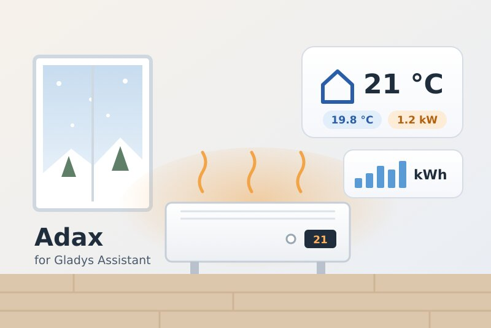
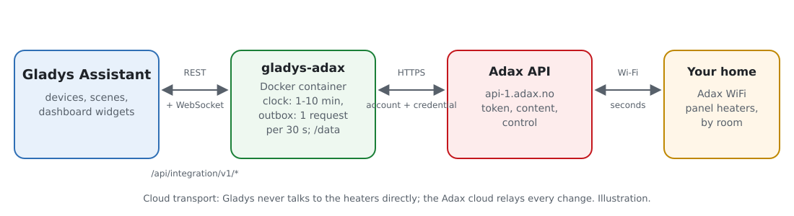
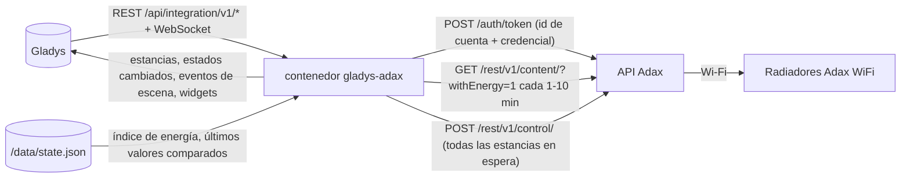
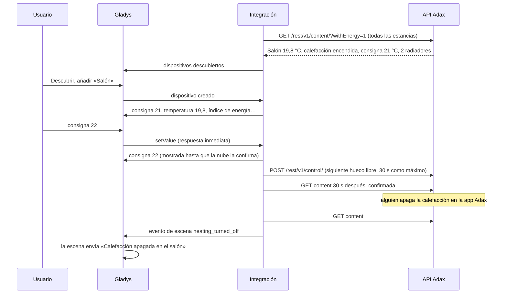
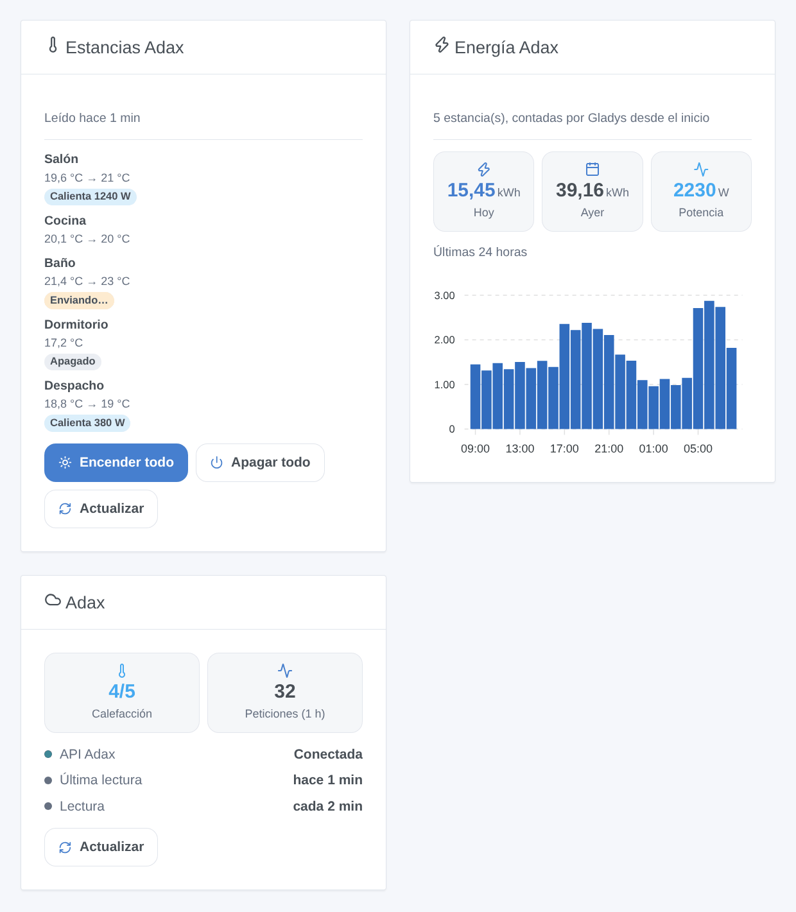

# Gladys Adax

[English](README.md) · [Français](README.fr.md) · [Deutsch](README.de.md) · **Español**

[](LICENSE)
[](https://github.com/William-De71/gladys-adax/releases)
[](https://github.com/William-De71/gladys-adax/actions/workflows/release.yml)
[](https://gladysassistant.com)



Integración externa de [Gladys Assistant](https://gladysassistant.com) para los radiadores **Adax WiFi**: un dispositivo por estancia con su consigna, la calefacción encendida o apagada, la temperatura, la potencia y un índice de energía. Usa la API oficial de Adax con una credencial de la app Adax WiFi, y añade disparadores y acciones de escena y widgets para las estancias y la energía de las últimas 24 horas.

Documentación de usuario: [English](docs/en.md) · [Français](docs/fr.md) · [Deutsch](docs/de.md) · [Español](docs/es.md).

Sin relación con Adax. **Aún no probada con una cuenta Adax real**: las peticiones siguen la documentación oficial y el documento OpenAPI de la API de Adax, y el ritmo de [pyAdax](https://github.com/Danielhiversen/pyAdax), la biblioteca del componente de Home Assistant.

## Funciones

- **Un dispositivo por estancia** de la app Adax (la API ajusta estancias, no radiadores sueltos): consigna (5 a 35 °C por grados enteros), calefacción encendida o apagada, temperatura ambiente y, cuando los radiadores informan de su energía, si calientan, la potencia media y un **índice de energía** para el panel de energía de Gladys.
- Todas las estancias leídas en **una petición** cada 1, 2, 5 o 10 minutos; las órdenes se muestran al instante y se agrupan en **una petición de control**, en 30 segundos como máximo (Adax acepta una petición cada 30 segundos).
- **3 disparadores de escena**, **3 acciones de escena** y **3 widgets** (abajo), un botón **Probar la conexión**.
- La limitación de Adax está contemplada: un 402 «Request limit exceeded» espacia las lecturas en lugar de insistir.
- Cuatro idiomas en todas partes: inglés, francés, alemán y español.

## Funcionamiento





De una consigna a una escena:



### Transporte

`transports: ["cloud"]`: cada petición va a `api-1.adax.no` con su id de cuenta y su credencial; la nube de Adax transmite los cambios a los radiadores. El modo local de los radiadores más recientes necesita un emparejamiento Bluetooth que un contenedor no puede hacer. `/data` guarda el índice de energía de cada estancia, la energía de las últimas 48 horas y los últimos valores que comparan los disparadores.

## Dispositivos y funciones

| Función              | Categoría / tipo                    | Unidad                | Modificable |
| -------------------- | ----------------------------------- | --------------------- | ----------- |
| Consigna             | `thermostat` / `target-temperature` | °C, 5–35 de 1 en 1    | sí          |
| Calefacción          | `thermostat` / `mode`               | apagada / calefacción | sí          |
| Temperatura ambiente | `temperature-sensor` / `decimal`    | °C                    | no          |
| Calentando           | `thermostat` / `operating-state`    | reposo / calentando   | no          |
| Potencia             | `energy-sensor` / `power`           | W                     | no          |
| Energía              | `energy-sensor` / `index`           | kWh (acumulados)      | no          |

Una estancia cuyos radiadores informan de su energía tiene 6 funciones, las demás 3. Una estancia sin radiador no se ofrece. Adax ignora una consigna con la calefacción apagada: una consigna siempre enciende la calefacción. La energía de un radiador sube durante la hora y vuelve a 0 cada hora ([home-assistant/core#150994](https://github.com/home-assistant/core/issues/150994)): la integración suma los aumentos en un índice guardado en `/data`.

## Disparadores, acciones de escena y widgets



Widgets:

- **Estancias Adax**: temperatura, consigna y una insignia por estancia (apagada, calentando con su potencia, orden enviándose), detalles al tocar, **Encender todo** / **Apagar todo** para las estancias del widget en una petición, **Actualizar**. Ajustes: las estancias mostradas (8 como máximo).
- **Energía Adax**: energía de hoy y de ayer, potencia actual, gráfico de barras de las últimas 24 horas. Ajustes: las estancias contadas.
- **Adax**: conexión a la API, estancias con calefacción, peticiones de la última hora, **Actualizar**.

Disparadores de escena (cada uno filtrable por estancia): se enciende la calefacción de una estancia, se apaga, cambia la consigna de una estancia (en la app Adax, en el radiador o por su programa, nunca por la propia Gladys; la consigna anterior es una variable).

Acciones de escena: ajustar la consigna de una estancia o de todas, encender o apagar la calefacción (una estancia o todas), leer las estancias ahora (devuelve la energía de hoy).

Ejemplos:

- Cuando todos salen de casa → todas las estancias a 16 °C; cuando alguien vuelve → 21 °C.
- Cuando el precio de la electricidad de la hora es alto → apagar la calefacción de los dormitorios durante una hora.
- Cuando la consigna cambia en la app Adax → notificar «{{triggerEvent.data.device_name}}: {{triggerEvent.data.target_temperature}} °C».

## Requisitos

- Gladys Assistant **5.3.0** o posterior (las instancias más antiguas no pueden instalarla).
- Radiadores Adax WiFi configurados en la app Adax WiFi (3.7 o posterior), cada uno en una estancia.
- En la app, Cuenta → Remote user client API: el id de cuenta y la contraseña de una credencial creada con «Add credential».

## Instalación

- **Desde la tienda**: Integraciones → Adax → Instalar.
- **Desde la URL del repositorio**: Integraciones → integración externa → `https://github.com/William-De71/gladys-adax`.
- **Modo desarrollador**: ejecute `npm start` con las variables que da Gladys (véase Desarrollo).

## Configuración

| Campo o botón                            | Por defecto | Significado                                                       |
| ---------------------------------------- | ----------- | ----------------------------------------------------------------- |
| Id de cuenta                             | —           | Obligatorio, lo muestra la app Adax WiFi                          |
| Contraseña de la credencial              | —           | Obligatorio, un secreto: nunca se vuelve a mostrar ni se registra |
| Intervalo de lectura                     | 2 min       | 1, 2, 5 o 10 minutos; una petición para todas las estancias       |
| Idioma de los textos de los dispositivos | automático  | Nombres de las funciones y mensajes del botón                     |
| Probar la conexión                       | —           | Lee las estancias y las lista con sus radiadores y funciones      |

## Uso

1. Pegue el id de cuenta y la contraseña de la credencial y pulse **Probar la conexión** (Integraciones → Adax → Configuración).
2. **Descubrir**, y añada como dispositivos las estancias que quiera.
3. Añada los widgets **Estancias Adax** y **Energía Adax** (y el widget **Termostato** de Gladys sobre una consigna) a un panel.
4. Cree escenas con las funciones, los disparadores y las acciones.

## Desarrollo

```bash
npm install
npm test                       # node --test, nunca accede a la red
npm run lint                   # ESLint
npm run format:check           # Prettier
npx github:GladysAssistant/integration-store . --skip-image-check
scripts/build-cover.sh         # cover.jpg desde docs/assets/cover.svg
docs/illustrations/render.sh   # docs/assets/widgets.<lang>.png
```

En local, el SDK lee `GLADYS_HOST_API_URL`, `GLADYS_INTEGRATION_TOKEN` y `GLADYS_INTEGRATION_SELECTOR` (dadas por Gladys en modo desarrollador), y la integración lee `TZ` (los días del widget de energía). `DEBUG=gladys-integration-sdk` muestra los registros del SDK.

Las pruebas cubren el cliente de la API (concesión por contraseña, renovación del token, espaciado de 30 segundos, credenciales rechazadas, 401 / 402 / 403 / 429 / 500, API inaccesible), el modelo de datos (centésimas de grado, límites de la consigna, codificación de órdenes, diente de sierra de la energía y valores anómalos), los dispositivos (campos que exige la pantalla Descubrir, pares categoría / tipo), los disparadores, los widgets (`validateWidgetContent`), el manifiesto, los cuatro idiomas, el script de publicación y toda la integración frente al Gladys falso del SDK y una API falsa (cola de órdenes, valores ordenados, rechazos, ralentización, varias casas, reinicio). `test/structure.test.js` congela todas las claves guardadas por los usuarios.

## Proceso de publicación


Cada fusión en `main` ejecuta la CI y calcula la versión a partir de los [Conventional Commits](https://www.conventionalcommits.org/) desde la última etiqueta: `feat` → menor, `fix` / `perf` → parche, `!` o `BREAKING CHANGE` → mayor (menor por debajo de 1.0.0); `docs`, `chore`, `ci`, `test`, `style`, `refactor`, `build` solos no publican nada. Se genera la sección del changelog, se sube la etiqueta, se construye la imagen multiarquitectura, `main` recibe el commit de publicación, se crea la GitHub Release y un último trabajo comprueba la imagen pública, el validador de la tienda y el topic.

- El título del pull request se convierte en el commit squash y luego en la línea del changelog: escríbalo en inglés, para el usuario (`pr-title.yml` lo comprueba). No edite nunca `CHANGELOG.md` a mano.
- La 1.0.0 es una decisión: Actions → Release → Run workflow con `release-as: 1.0.0`. `dry-run` muestra la versión y las notas sin publicar.
- **Rama protegida**: la publicación sube su commit a `main` con `GITHUB_TOKEN`. El ruleset `protect-main` (sin borrado ni force-push) lo deja pasar; una regla más estricta (pull request obligatorio, status checks) necesitaría GitHub Actions en su lista de excepciones, o una GitHub App.
- Tras la primera publicación, haga público el paquete de `ghcr.io` (Package settings → Change visibility), o Gladys no podrá descargarlo.

## Solución de problemas

Véase [docs/es.md](docs/es.md#solución-de-problemas). Informe de los problemas con las versiones de Gladys y de la integración, sus modelos de radiadores Adax, el resultado de «Probar la conexión» y los registros de la integración. No pegue nunca la contraseña de su credencial.

## Contribuir

Issues y pull requests son bienvenidos. Ejecute `npm run format:check && npm run lint && npm test` antes de abrir un pull request y mantenga sin cambios todos los identificadores externos y claves guardadas (véase [CLAUDE.md](CLAUDE.md)).

## Seguridad

Véase [SECURITY.md](SECURITY.md): informe de las vulnerabilidades en privado. La contraseña de la credencial es un campo `secret`: nunca se registra, nunca se escribe en `/data`, solo se envía a `api-1.adax.no` por HTTPS para obtener un token; ni el token ni la contraseña aparecen en un mensaje de error. Borre la credencial en la app Adax WiFi para retirar el acceso en cualquier momento.

## Capturas pendientes

Las imágenes de arriba son ilustraciones, no capturas de pantalla. Las capturas reales irán en `docs/assets/screenshots/` (PNG, 1280 × 800): `configuration.png` (credenciales y «Probar la conexión»), `discovery.png`, `device.png` (una estancia), `scene.png`.

## Licencia

[Licencia Apache 2.0](LICENSE) — véase también [NOTICE](NOTICE). Adax es una marca de Adax AS. Los datos de la API vienen de la documentación oficial de Adax; el ritmo de una petición cada 30 segundos de [pyAdax](https://github.com/Danielhiversen/pyAdax) (MIT) de Daniel Hjelseth Høyer, citado en NOTICE; no se copió código. Gracias a la documentación y al SDK de Gladys.
