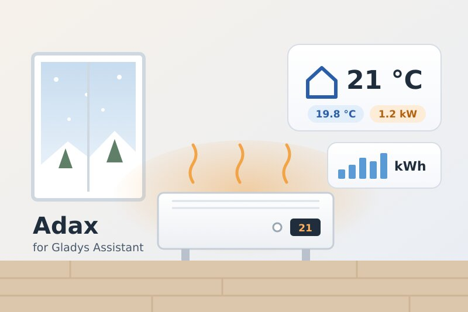
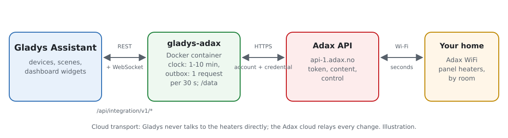
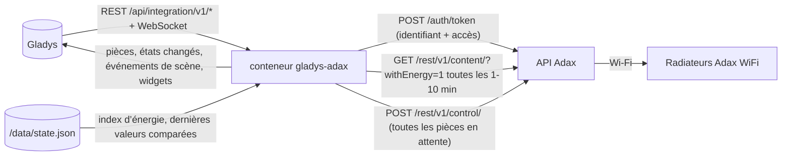
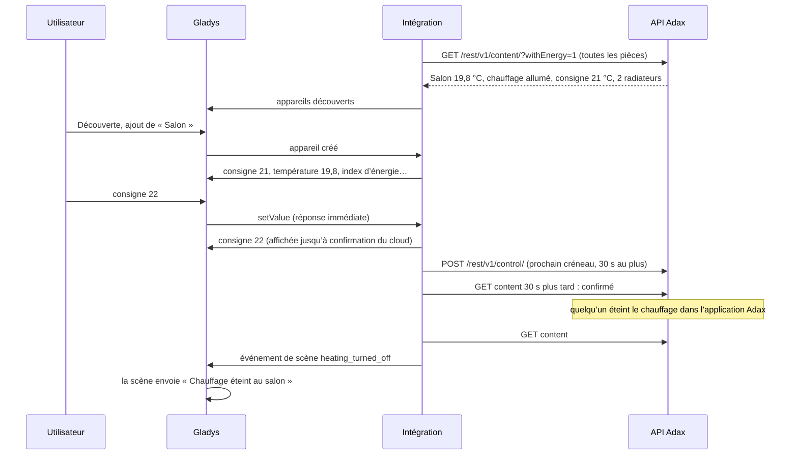
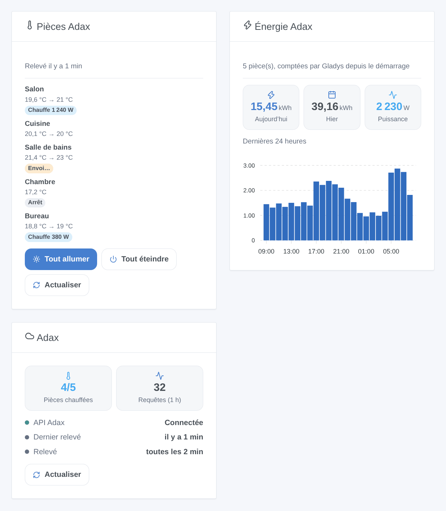

# Gladys Adax

[English](README.md) · **Français** · [Deutsch](README.de.md) · [Español](README.es.md)

[](LICENSE)
[](https://github.com/William-De71/gladys-adax/releases)
[](https://github.com/William-De71/gladys-adax/actions/workflows/release.yml)
[](https://gladysassistant.com)



Intégration externe [Gladys Assistant](https://gladysassistant.com) pour les radiateurs **Adax WiFi** : un appareil par pièce avec sa consigne, le chauffage allumé ou éteint, la température, la puissance et un index d’énergie. Elle utilise l’API officielle d’Adax avec un accès créé dans l’application Adax WiFi, et ajoute des déclencheurs et actions de scène ainsi que des widgets pour les pièces et l’énergie des dernières 24 heures.

Documentation utilisateur : [English](docs/en.md) · [Français](docs/fr.md) · [Deutsch](docs/de.md) · [Español](docs/es.md).

Sans lien avec Adax. **Pas encore testée avec un vrai compte Adax** : les requêtes suivent la documentation officielle et le document OpenAPI de l’API Adax, et le rythme de [pyAdax](https://github.com/Danielhiversen/pyAdax), la bibliothèque du composant Home Assistant.

## Fonctionnalités

- **Un appareil par pièce** de l’application Adax (l’API règle des pièces, pas des radiateurs seuls) : consigne (5 à 35 °C par degré entier), chauffage allumé ou éteint, température ambiante et, quand les radiateurs remontent leur énergie, la chauffe en cours, la puissance moyenne et un **index d’énergie** pour le tableau de bord énergie de Gladys.
- Toutes les pièces relevées en **une requête** toutes les 1, 2, 5 ou 10 minutes ; les commandes affichées tout de suite et regroupées en **une requête de pilotage**, en 30 secondes au plus (Adax accepte une requête toutes les 30 secondes).
- **3 déclencheurs de scène**, **3 actions de scène** et **3 widgets** (ci-dessous), un bouton **Tester la connexion**.
- La limitation d’Adax est gérée : un 402 « Request limit exceeded » espace les relevés au lieu d’insister.
- Quatre langues partout : anglais, français, allemand, espagnol.

## Fonctionnement





D’une consigne à une scène :



### Transport

`transports: ["cloud"]` : chaque requête part vers `api-1.adax.no` avec votre identifiant de compte et votre accès ; le cloud Adax relaie les changements aux radiateurs. Le mode local des radiateurs les plus récents demande un appairage Bluetooth qu’un conteneur ne peut pas faire. `/data` garde l’index d’énergie de chaque pièce, l’énergie des 48 dernières heures et les dernières valeurs comparées par les déclencheurs.

## Appareils et fonctionnalités

| Fonctionnalité       | Catégorie / type                    | Unité             | Modifiable |
| -------------------- | ----------------------------------- | ----------------- | ---------- |
| Consigne             | `thermostat` / `target-temperature` | °C, 5–35 par 1    | oui        |
| Chauffage            | `thermostat` / `mode`               | arrêt / chauffage | oui        |
| Température ambiante | `temperature-sensor` / `decimal`    | °C                | non        |
| Chauffe              | `thermostat` / `operating-state`    | repos / chauffe   | non        |
| Puissance            | `energy-sensor` / `power`           | W                 | non        |
| Énergie              | `energy-sensor` / `index`           | kWh (cumulés)     | non        |

Une pièce dont les radiateurs remontent leur énergie a 6 fonctionnalités, les autres 3. Une pièce sans radiateur n’est pas proposée. Adax ignore une consigne quand le chauffage est éteint : une consigne allume toujours le chauffage. L’énergie d’un radiateur monte pendant l’heure puis repart de 0 à chaque heure ([home-assistant/core#150994](https://github.com/home-assistant/core/issues/150994)) : l’intégration additionne les hausses dans un index gardé dans `/data`.

## Déclencheurs, actions de scène et widgets



Widgets :

- **Pièces Adax** : température, consigne et un badge par pièce (arrêt, chauffe avec sa puissance, commande en cours d’envoi), détails au toucher, **Tout allumer** / **Tout éteindre** pour les pièces du widget en une requête, **Actualiser**. Réglages : les pièces affichées (8 au plus).
- **Énergie Adax** : énergie d’aujourd’hui et d’hier, puissance actuelle, histogramme des dernières 24 heures. Réglages : les pièces comptées.
- **Adax** : connexion à l’API, pièces en chauffe, requêtes de la dernière heure, **Actualiser**.

Déclencheurs de scène (chacun filtrable par pièce) : le chauffage d’une pièce est allumé, est éteint, la consigne d’une pièce change (dans l’application Adax, sur le radiateur ou par son programme, jamais par Gladys elle-même ; la consigne précédente est une variable).

Actions de scène : régler la consigne d’une pièce ou de toutes, allumer ou éteindre le chauffage (une pièce ou toutes), relever les pièces maintenant (renvoie l’énergie du jour).

Exemples :

- Quand tout le monde quitte la maison → toutes les pièces à 16 °C ; au retour de quelqu’un → 21 °C.
- Quand le prix de l’électricité de l’heure est élevé → éteindre le chauffage des chambres pendant une heure.
- Quand la consigne change dans l’application Adax → notifier « {{triggerEvent.data.device_name}} : {{triggerEvent.data.target_temperature}} °C ».

## Prérequis

- Gladys Assistant **5.3.0** ou plus récent (les instances plus anciennes ne peuvent pas l’installer).
- Des radiateurs Adax WiFi installés dans l’application Adax WiFi (3.7 ou plus), chacun dans une pièce.
- Dans l’application, Compte → Remote user client API : l’identifiant de compte, et le mot de passe d’un accès créé avec « Add credential ».

## Installation

- **Depuis le store** : Intégrations → Adax → Installer.
- **Depuis l’URL du dépôt** : Intégrations → intégration externe → `https://github.com/William-De71/gladys-adax`.
- **Mode développeur** : lancez `npm start` avec les variables fournies par Gladys (voir Développement).

## Configuration

| Champ ou bouton                 | Défaut      | Rôle                                                                    |
| ------------------------------- | ----------- | ----------------------------------------------------------------------- |
| Identifiant de compte           | —           | Obligatoire, affiché dans l’application Adax WiFi                       |
| Mot de passe de l’accès         | —           | Obligatoire, un secret : jamais réaffiché, jamais journalisé            |
| Intervalle de relevé            | 2 min       | 1, 2, 5 ou 10 minutes ; une requête pour toutes les pièces              |
| Langue des textes des appareils | automatique | Noms des fonctionnalités et messages du bouton                          |
| Tester la connexion             | —           | Relève les pièces et les liste avec leurs radiateurs et fonctionnalités |

## Utilisation

1. Collez l’identifiant de compte et le mot de passe de l’accès, puis cliquez sur **Tester la connexion** (Intégrations → Adax → Configuration).
2. **Découverte**, puis ajoutez les pièces voulues comme appareils.
3. Ajoutez les widgets **Pièces Adax** et **Énergie Adax** (et le widget **Thermostat** de Gladys sur une consigne) à un tableau de bord.
4. Construisez des scènes avec les fonctionnalités, les déclencheurs et les actions.

## Développement

```bash
npm install
npm test                       # node --test, ne touche jamais le réseau
npm run lint                   # ESLint
npm run format:check           # Prettier
npx github:GladysAssistant/integration-store . --skip-image-check
scripts/build-cover.sh         # cover.jpg depuis docs/assets/cover.svg
docs/illustrations/render.sh   # docs/assets/widgets.<lang>.png
```

En local, le SDK lit `GLADYS_HOST_API_URL`, `GLADYS_INTEGRATION_TOKEN` et `GLADYS_INTEGRATION_SELECTOR` (fournies par Gladys en mode développeur), et l’intégration lit `TZ` (les jours du widget énergie). `DEBUG=gladys-integration-sdk` affiche les journaux du SDK.

Les tests couvrent le client de l’API (jeton par mot de passe, renouvellement, espacement de 30 secondes, identifiants refusés, 401 / 402 / 403 / 429 / 500, API injoignable), le modèle de données (centièmes de degré, bornes de consigne, encodage des commandes, dents de scie de l’énergie et valeurs aberrantes), les appareils (champs exigés par l’écran Découverte, couples catégorie / type), les déclencheurs, les widgets (`validateWidgetContent`), le manifeste, les quatre langues, le script de release, et toute l’intégration face au faux Gladys du SDK et à une fausse API (file de commandes, valeurs commandées, refus, ralentissement, plusieurs maisons, redémarrage). `test/structure.test.js` fige toutes les clés enregistrées chez les utilisateurs.

## Processus de release


Chaque fusion sur `main` lance la CI, puis calcule la version à partir des [Conventional Commits](https://www.conventionalcommits.org/) depuis le dernier tag : `feat` → mineure, `fix` / `perf` → correctif, `!` ou `BREAKING CHANGE` → majeure (mineure sous 1.0.0) ; `docs`, `chore`, `ci`, `test`, `style`, `refactor`, `build` seuls ne publient rien. La section du changelog est générée, le tag poussé, l’image multi-architecture construite, puis `main` reçoit le commit de release, la GitHub Release est créée et un dernier job vérifie l’image publique, le validateur du store et le topic.

- Le titre de la pull request devient le commit squash, puis la ligne du changelog : écrivez-le en anglais, pour l’utilisateur (`pr-title.yml` le vérifie). Ne modifiez jamais `CHANGELOG.md` à la main.
- La 1.0.0 est une décision : Actions → Release → Run workflow avec `release-as: 1.0.0`. `dry-run` montre la version et les notes sans rien publier.
- **Branche protégée** : la release pousse son commit sur `main` avec `GITHUB_TOKEN`. Le ruleset `protect-main` (pas de suppression, pas de force-push) le laisse passer ; une règle plus stricte (pull request obligatoire, status checks) demanderait d’ajouter GitHub Actions à sa liste de contournement, ou une GitHub App.
- Après la première release, rendez public le paquet `ghcr.io` (Package settings → Change visibility), sinon Gladys ne peut pas le télécharger.

## Dépannage

Voir [docs/fr.md](docs/fr.md#dépannage). Signalez un problème avec les versions de Gladys et de l’intégration, vos modèles de radiateurs Adax, le résultat de « Tester la connexion » et les journaux de l’intégration. Ne collez jamais le mot de passe de votre accès.

## Contribuer

Issues et pull requests bienvenues. Lancez `npm run format:check && npm run lint && npm test` avant d’ouvrir une pull request, et gardez inchangés tous les identifiants externes et clés enregistrées (voir [CLAUDE.md](CLAUDE.md)).

## Sécurité

Voir [SECURITY.md](SECURITY.md) : signalez les failles en privé. Le mot de passe de l’accès est un champ `secret` : jamais journalisé, jamais écrit dans `/data`, envoyé uniquement à `api-1.adax.no` en HTTPS pour obtenir un jeton ; ni le jeton ni le mot de passe n’apparaissent dans un message d’erreur. Supprimez l’accès dans l’application Adax WiFi pour retirer l’accès à tout moment.

## Captures à venir

Les images ci-dessus sont des illustrations, pas des captures d’écran. Les vraies captures iront dans `docs/assets/screenshots/` (PNG, 1280 × 800) : `configuration.png` (identifiants et « Tester la connexion »), `discovery.png`, `device.png` (une pièce), `scene.png`.

## Licence

[Licence Apache 2.0](LICENSE) — voir aussi [NOTICE](NOTICE). Adax est une marque d’Adax AS. Les faits sur l’API viennent de la documentation officielle d’Adax ; le rythme d’une requête toutes les 30 secondes de [pyAdax](https://github.com/Danielhiversen/pyAdax) (MIT) de Daniel Hjelseth Høyer, crédité dans NOTICE ; aucun code n’a été copié. Merci à la documentation et au SDK de Gladys.
