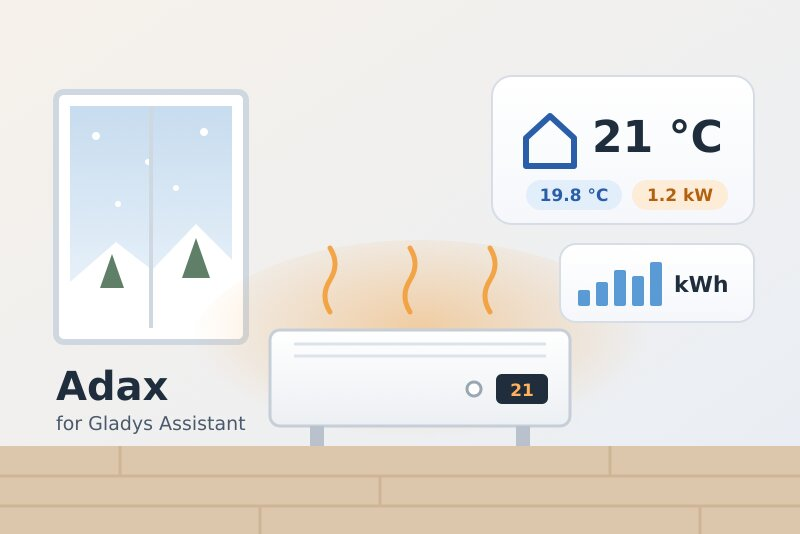
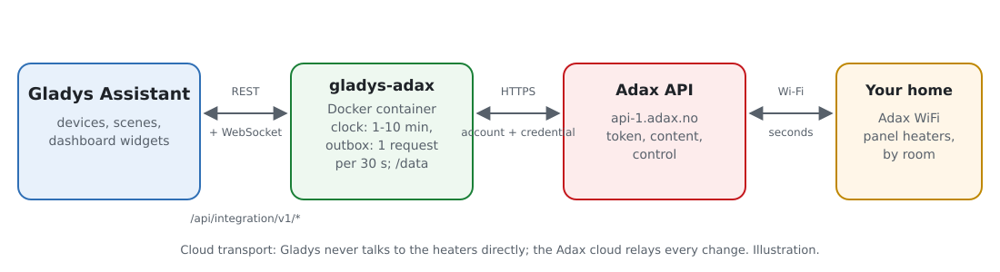
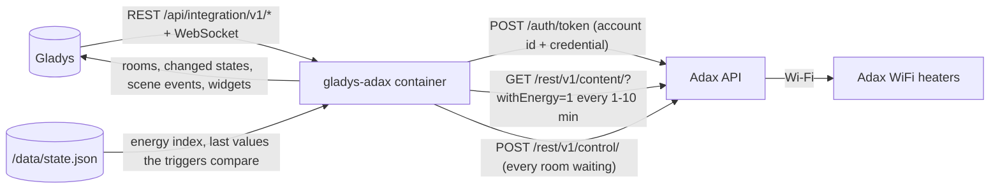
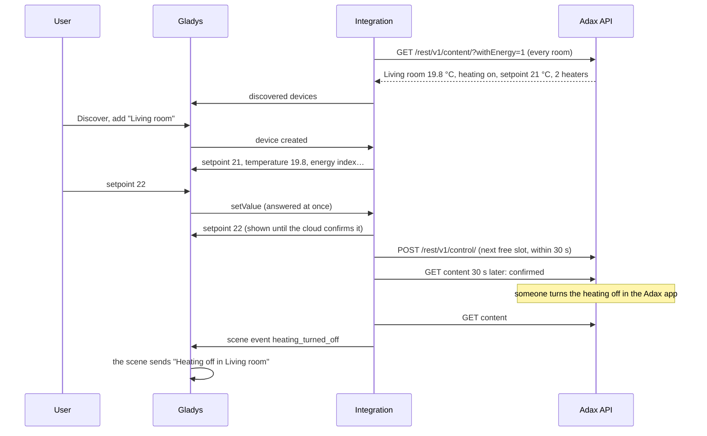
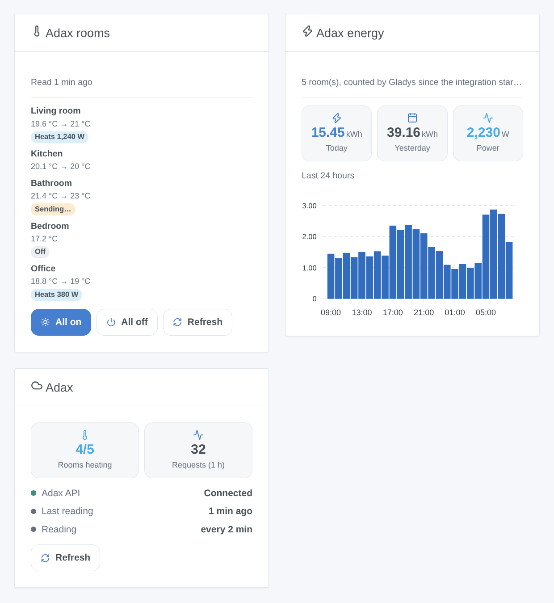

# Gladys Adax

**English** · [Français](README.fr.md) · [Deutsch](README.de.md) · [Español](README.es.md)

[](LICENSE)
[](https://github.com/William-De71/gladys-adax/releases)
[](https://github.com/William-De71/gladys-adax/actions/workflows/release.yml)
[](https://gladysassistant.com)



[Gladys Assistant](https://gladysassistant.com) external integration for **Adax WiFi** panel heaters: one device per room with its setpoint, heating on / off, temperature, power and energy index. It uses the official Adax API with a credential of the Adax WiFi app, adds scene triggers and actions, and widgets for the rooms and the energy of the last 24 hours.

User documentation: [English](docs/en.md) · [Français](docs/fr.md) · [Deutsch](docs/de.md) · [Español](docs/es.md).

Not affiliated with Adax. **Not tested with a real Adax account yet**: the requests follow the official documentation and OpenAPI document of the Adax API, and the pace of [pyAdax](https://github.com/Danielhiversen/pyAdax), the library of the Home Assistant component.

## Features

- **One device per room** of the Adax app (the API sets rooms, not single heaters): setpoint (5 to 35 °C by whole degrees), heating on / off, room temperature, and, when the heaters report their energy, heating now, average power and an **energy index** for the Gladys energy dashboard.
- Every room read in **one request** every 1, 2, 5 or 10 minutes; commands shown at once and grouped in **one control request**, within 30 seconds (Adax accepts one request every 30 seconds).
- **3 scene triggers**, **3 scene actions** and **3 dashboard widgets** (below), a **Test the connection** button.
- Adax throttling handled: a 402 "Request limit exceeded" slows the readings down instead of insisting.
- Four languages everywhere: English, French, German, Spanish.

## How it works





From a setpoint to a scene:



### Transport

`transports: ["cloud"]`: every request goes to `api-1.adax.no` with your account id and credential; the Adax cloud relays the changes to the heaters. The local mode of the newest heaters needs a Bluetooth pairing a container cannot do. `/data` keeps the energy index of each room, the energy of the last 48 hours and the last values the scene triggers compare.

## Devices and features

| Feature          | Category / type                     | Unit            | Writable |
| ---------------- | ----------------------------------- | --------------- | -------- |
| Setpoint         | `thermostat` / `target-temperature` | °C, 5–35 by 1   | yes      |
| Heating          | `thermostat` / `mode`               | off / heating   | yes      |
| Room temperature | `temperature-sensor` / `decimal`    | °C              | no       |
| Heats            | `thermostat` / `operating-state`    | idle / heating  | no       |
| Power            | `energy-sensor` / `power`           | W               | no       |
| Energy           | `energy-sensor` / `index`           | kWh (cumulated) | no       |

A room whose heaters report their energy gets 6 features, the others 3. A room without heater is not offered. Adax ignores a setpoint while the heating is off: a setpoint always turns the heating on. The energy of a heater grows during the hour and restarts at 0 every hour ([home-assistant/core#150994](https://github.com/home-assistant/core/issues/150994)): the integration adds the increases into an index kept in `/data`.

## Scene triggers, actions and widgets



Widgets:

- **Adax rooms**: temperature, setpoint and a badge per room (off, heating with its power, command being sent), details on tap, **All on** / **All off** for the rooms of the widget in one request, **Refresh**. Settings: the rooms to show (8 at most).
- **Adax energy**: energy of today and yesterday, power now, bar chart of the last 24 hours. Settings: the rooms to count.
- **Adax**: connection to the API, rooms heating, requests of the last hour, **Refresh**.

Scene triggers (each one filtered by room): the heating of a room is turned on, is turned off, the setpoint of a room changes (in the Adax app, on the heater or by its schedule, never by Gladys itself; the previous setpoint is a variable).

Scene actions: set the setpoint of one room or of every room, turn the heating on or off (one room or every room), read the rooms now (outputs the energy of today).

Examples:

- When everybody leaves home → set every room to 16 °C; when somebody comes back → 21 °C.
- When the electricity price of the hour is high → turn the heating of the bedrooms off for an hour.
- When the setpoint changes in the Adax app → notify "{{triggerEvent.data.device_name}}: {{triggerEvent.data.target_temperature}} °C".

## Requirements

- Gladys Assistant **5.3.0** or later (older instances cannot install it).
- Adax WiFi heaters set up in the Adax WiFi app (3.7 or later), each one in a room.
- In the app, Account → Remote user client API: the account id, and the password of a credential created with "Add credential".

## Installation

- **From the store**: Integrations → Adax → Install.
- **From the repository URL**: Integrations → external integration → `https://github.com/William-De71/gladys-adax`.
- **Developer mode**: run `npm start` with the variables given by Gladys (see Development).

## Configuration

| Field or button              | Default   | Meaning                                                            |
| ---------------------------- | --------- | ------------------------------------------------------------------ |
| Account id                   | —         | Required, shown in the Adax WiFi app                               |
| Credential password          | —         | Required, a secret: never shown again, never logged                |
| Reading interval             | 2 min     | 1, 2, 5 or 10 minutes; one request for every room                  |
| Language of the device texts | automatic | Feature names and button messages                                  |
| Test the connection          | —         | Reads the rooms now and lists them with their heaters and features |

## Usage

1. Paste the account id and the credential password, then press **Test the connection** (Integrations → Adax → Configuration).
2. **Discover**, then add the rooms you want as devices.
3. Add the **Adax rooms** and **Adax energy** widgets (and the Gladys **Thermostat** widget on a setpoint) to a dashboard.
4. Build scenes with the device features, the triggers and the actions.

## Development

```bash
npm install
npm test                       # node --test, never touches the network
npm run lint                   # ESLint
npm run format:check           # Prettier
npx github:GladysAssistant/integration-store . --skip-image-check
scripts/build-cover.sh         # cover.jpg from docs/assets/cover.svg
docs/illustrations/render.sh   # docs/assets/widgets.<lang>.png
```

Locally, the SDK reads `GLADYS_HOST_API_URL`, `GLADYS_INTEGRATION_TOKEN` and `GLADYS_INTEGRATION_SELECTOR` (given by Gladys in developer mode), and the integration reads `TZ` (the days of the energy widget). `DEBUG=gladys-integration-sdk` shows the SDK logs.

The tests cover the API client (password grant, token renewal, 30-second spacing, wrong credentials, 401 / 402 / 403 / 429 / 500, unreachable API), the data model (hundredths of a degree, setpoint bounds, control encoding, energy saw tooth and glitches), the devices (the fields the Discovery screen requires, category / type pairs), the scene triggers, the widgets (`validateWidgetContent`), the manifest, the four languages, the release script, and the whole integration against the fake Gladys of the SDK and a fake API (outbox, commanded values, refusals, slow-down, several homes, restart). `test/structure.test.js` freezes every key users store.

## Release process


Every merge on `main` runs the CI, then computes the version from the [Conventional Commits](https://www.conventionalcommits.org/) since the last tag: `feat` → minor, `fix` / `perf` → patch, `!` or `BREAKING CHANGE` → major (a minor below 1.0.0); `docs`, `chore`, `ci`, `test`, `style`, `refactor`, `build` alone publish nothing. The changelog section is generated, the tag pushed, the multi-architecture image built, then `main` receives the release commit, the GitHub Release is created and a last job checks the public image, the store validator and the topic.

- The pull request title becomes the squash commit, then the changelog line: write it in English, for the user (`pr-title.yml` checks it). Never edit `CHANGELOG.md` by hand.
- 1.0.0 is a decision: Actions → Release → Run workflow with `release-as: 1.0.0`. `dry-run` shows the version and the notes without publishing.
- **Protected branch**: the release pushes its commit to `main` with `GITHUB_TOKEN`. The `protect-main` ruleset (no deletion, no force-push) lets it through; a stricter rule (pull request required, status checks) would need GitHub Actions in its bypass list, or a GitHub App.
- After the first release, make the `ghcr.io` package public (Package settings → Change visibility), or Gladys cannot pull it.

## Troubleshooting

See [docs/en.md](docs/en.md#troubleshooting). Report issues with the versions of Gladys and of the integration, your Adax heater models, the result of "Test the connection" and the logs of the integration. Never paste your credential password.

## Contributing

Issues and pull requests are welcome. Run `npm run format:check && npm run lint && npm test` before opening a pull request, and keep every external id and stored key unchanged (see [CLAUDE.md](CLAUDE.md)).

## Security

See [SECURITY.md](SECURITY.md): report vulnerabilities privately. The credential password is a `secret` field: never logged, never written to `/data`, sent only to `api-1.adax.no` over HTTPS to get a token; neither the token nor the password appears in an error message. Delete the credential in the Adax WiFi app to revoke the access at any time.

## Screenshots to come

The images above are illustrations, not screenshots. Real screenshots will go in `docs/assets/screenshots/` (PNG, 1280 × 800): `configuration.png` (credentials and "Test the connection"), `discovery.png`, `device.png` (a room), `scene.png`.

## License

[Apache License 2.0](LICENSE) — see also [NOTICE](NOTICE). Adax is a trademark of Adax AS. The API facts come from the official Adax documentation; the pace of one request every 30 seconds from [pyAdax](https://github.com/Danielhiversen/pyAdax) (MIT) by Daniel Hjelseth Høyer, credited in NOTICE; no code was copied. Thanks to the Gladys documentation and SDK.
