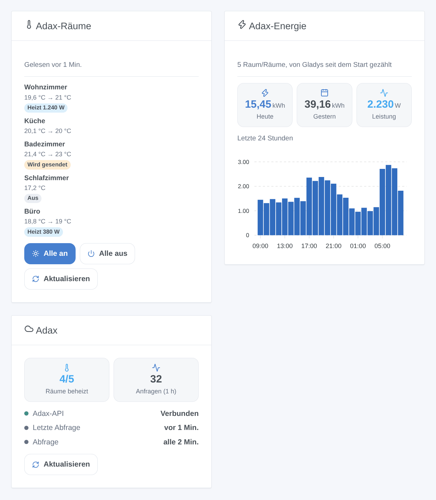

# Adax

## Überblick

Diese Integration bringt Ihre **Adax-WiFi**-Heizgeräte in Gladys. Sie nutzt die **offizielle Adax-API** (die „Remote user client API“ der Adax-WiFi-App) mit Ihrer Konto-ID und einem Zugang, den Sie in der App anlegen.

- Ein Gladys-Gerät pro **Raum** der Adax-App: Sollwert, Heizung an oder aus, Raumtemperatur und, wenn Ihre Heizgeräte sie melden, aktuelles Heizen, Leistung und ein Energiezähler für das Energie-Dashboard von Gladys.
- Szenenauslöser (Heizung ein- oder ausgeschaltet, Sollwert in der Adax-App oder am Heizgerät geändert) und Szenenaktionen (Sollwert eines Raums oder aller Räume, Heizung an oder aus, sofort abfragen).
- Drei Dashboard-Widgets: die Räume mit den Schaltflächen „Alle an“ und „Alle aus“, die Energie von heute und der letzten 24 Stunden sowie die Verbindung.

**Transport: Cloud.** Gladys spricht nie direkt mit Ihren Heizgeräten: Sie liest und schreibt in der Adax-Cloud, die die Änderungen an die Heizgeräte weitergibt. Adax akzeptiert **eine Anfrage alle 30 Sekunden**: Eine Änderung in Gladys wird sofort angezeigt und erreicht das Heizgerät **innerhalb von 30 Sekunden**; eine Änderung in der Adax-App oder am Heizgerät erreicht Gladys bei der nächsten Abfrage. Die Daten Ihrer Heizgeräte verlassen Ihr Zuhause (das tun sie mit der Adax-App bereits).

Nicht mit Adax verbunden. Noch nicht mit einem echten Adax-Konto getestet: Bitte melden Sie, was funktioniert und was nicht.

## Voraussetzungen

- Gladys Assistant **5.3.0** oder neuer.
- Adax-**WiFi**-Heizgeräte, eingerichtet in der **Adax-WiFi-App** (Version 3.7 oder neuer), jedes einem **Raum** zugeordnet: Die API stellt die Temperatur von Räumen ein, nicht die eines einzelnen Heizgeräts.
- In der App: Reiter **Konto** → **Remote user client API**: Notieren Sie die dort angezeigte **Konto-ID**, tippen Sie dann auf **Add credential**, vergeben Sie einen Namen (zum Beispiel „Gladys“) und kopieren Sie das **erzeugte Passwort**. Sie können diesen Zugang jederzeit löschen, um Gladys den Zugriff zu entziehen.

## Konfiguration

Öffnen Sie in Gladys **Integrationen → Adax**:

| Feld                    | Beschreibung                                                                             |
| ----------------------- | ---------------------------------------------------------------------------------------- |
| Konto-ID                | Die Nummer in der Adax-WiFi-App, Konto → Remote user client API.                         |
| Passwort des Zugangs    | Das Passwort des Zugangs: nur an Adax gesendet, nie wieder angezeigt oder protokolliert. |
| Abfrageintervall        | Alle 1, 2, 5 oder 10 Minuten (standardmäßig 2). Eine Anfrage liest alle Räume.           |
| Sprache der Gerätetexte | Namen der Funktionen und Meldungen der Schaltfläche; standardmäßig automatisch.          |

Klicken Sie auf **Verbindung testen**: Die Integration liest Ihre Räume und listet sie mit ihren Heizgeräten und Funktionen auf. Öffnen Sie dann den Reiter **Entdecken** und fügen Sie die gewünschten Räume hinzu: Ohne Sie wird nichts angelegt. Bei mehreren Zuhause in der App wird das Zuhause an den Raumnamen angehängt.

## Verwendung

### Geräte

Jeder Raum bietet diese Funktionen:

| Funktion       | Gladys-Typ                                         | Hinweise                                                                                                                          |
| -------------- | -------------------------------------------------- | --------------------------------------------------------------------------------------------------------------------------------- |
| Solltemperatur | Thermostat-Sollwert, 5 bis 35 °C in 1-°C-Schritten | Adax ignoriert einen Sollwert bei ausgeschalteter Heizung: Eine Änderung des Sollwerts schaltet die Heizung des Raums ein.        |
| Heizung        | Thermostatmodus: aus oder heizen                   | Aus schaltet die Heizgeräte des Raums ab; heizen stellt den Sollwert wieder her (20 °C, wenn Adax keinen liefert).                |
| Raumtemperatur | Temperatursensor                                   | Von den Heizgeräten gemessen.                                                                                                     |
| Heizt          | Betriebszustand: Ruhe oder heizt                   | Ob die Heizgeräte seit der vorherigen Abfrage Strom bezogen haben. Nur wenn die Heizgeräte ihre Energie melden.                   |
| Leistung       | Leistung (W)                                       | Die mittlere Leistung des Raums seit der vorherigen Abfrage.                                                                      |
| Energie        | Energiezähler (kWh)                                | Von der Integration aus der von Adax gemeldeten Energie jeder Stunde gezählt; speist die Verbrauchs- und Kostenseiten von Gladys. |

Das **Thermostat**-Widget des Gladys-Dashboards funktioniert mit dem Sollwert. Der Energiezähler beginnt bei der ersten Abfrage eines Raums bei 0: Gladys verwendet nur seine Zunahmen. Bei einem Intervall von 2 Minuten können einige Prozent jeder Stunde fehlen (die Energie zwischen der letzten Abfrage einer Stunde und ihrem Ende); ein kürzeres Intervall verliert weniger.

### Dashboard-Widgets

- **Adax-Räume**: jeder Raum mit Temperatur und Sollwert, ein Badge (aus, heizt mit Leistung, Befehl wird gesendet). Tippen Sie auf einen Raum für die Details (Zuhause, Heizgeräte, Energiezähler). **Alle an** und **Alle aus** wirken nach einer Bestätigung in einer Anfrage auf die Räume des Widgets; **Aktualisieren** fragt sofort ab. Wählen Sie die Räume in den Widget-Einstellungen (höchstens 8).
- **Adax-Energie**: die Energie von heute und gestern, die aktuelle Leistung und ein Balkendiagramm der letzten 24 Stunden, für alle Räume oder die in den Einstellungen gewählten.
- **Adax**: der Zustand der Verbindung zur API, die beheizten Räume, die Anfragen der letzten Stunde, eine Schaltfläche **Aktualisieren**.

### Szenen

Auslöser (jeder lässt sich auf einen Raum beschränken):

- **Die Heizung eines Raums wird eingeschaltet** / **wird ausgeschaltet**: in der Adax-WiFi-App oder am Heizgerät, nie durch Gladys selbst.
- **Der Sollwert eines Raums ändert sich**: in der App, am Heizgerät oder durch den Wochenplan. Der vorherige Sollwert ist eine Variable des Auslösers.

Aktionen:

- **Sollwert der Räume einstellen**: ein Raum oder alle, 5 bis 35 °C; schaltet die Heizung ein (Ausgaben: geändert, abgelehnt, geschriebener Sollwert).
- **Heizung ein- oder ausschalten**: ein Raum oder alle (Ausgaben: geändert, abgelehnt).
- **Adax-Räume jetzt abfragen**: gibt die Räume, die beheizten Räume und die Energie von heute aus.

Beispiele:

- Wenn alle das Haus verlassen → Sollwert aller Räume auf 16 °C; wenn jemand zurückkommt → 21 °C.
- Wenn der Strompreis der Stunde hoch ist → Heizung der Schlafzimmer für eine Stunde ausschalten, dann wieder ein.
- Wenn sich der Sollwert eines Raums in der Adax-App ändert → Benachrichtigung „{{triggerEvent.data.device_name}}: {{triggerEvent.data.target_temperature}} °C“ senden.

### Transport

Der Katalog zeigt das Badge **Cloud**: Jede Anfrage geht an `api-1.adax.no`, mit Ihrem Zugang. Diese Integration nutzt nicht den lokalen Modus der neuesten Heizgeräte (er erfordert eine Bluetooth-Kopplung, die ein Container nicht leisten kann).

## Fehlerbehebung

- **„Adax lehnt die Zugangsdaten ab“**: Prüfen Sie die Konto-ID und legen Sie in der App einen neuen Zugang an, wenn Sie ihn gelöscht haben oder sich beim Passwort nicht sicher sind.
- **Verbunden, aber kein Raum**: Ordnen Sie Ihre Heizgeräte in der Adax-WiFi-App Räumen zu.
- **„Adax bittet um weniger Anfragen“**: Die API hat „Anfragelimit überschritten“ (402) geantwortet. Die Integration fragt seltener ab und kehrt dann von selbst zum normalen Takt zurück. Verwenden Sie denselben Zugang nicht in mehreren Programmen gleichzeitig.
- **Weder Leistung noch Energie**: Ihre Heizgeräte melden ihre Energie nicht an die Adax-Cloud; Sollwert, Heizung und Temperatur funktionieren trotzdem.
- **Ein Befehl dauert bis zu 30 Sekunden**: Adax akzeptiert eine Anfrage alle 30 Sekunden; das Badge „Wird gesendet“ zeigt einen wartenden Befehl.
- Melden Sie ein Problem auf [GitHub](https://github.com/William-De71/gladys-adax/issues) mit Ihrer Gladys-Version, der Version der Integration und dem Ergebnis von „Verbindung testen“.
