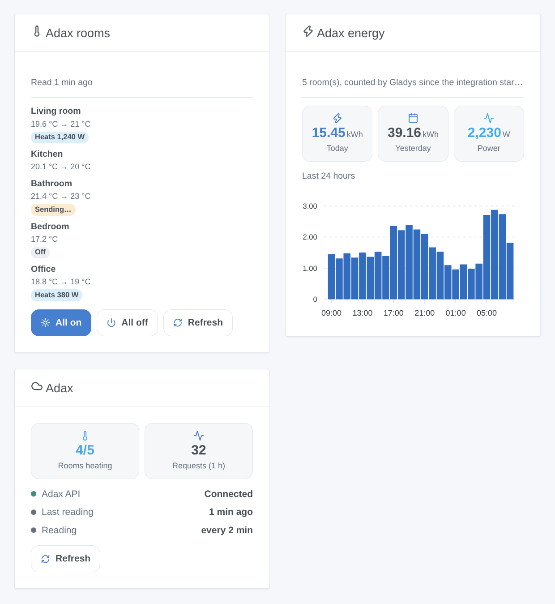

# Adax

## Overview

This integration brings your **Adax WiFi** panel heaters into Gladys. It uses the **official Adax API** (the "Remote user client API" of the Adax WiFi app), with your account id and a credential you create in the app.

- One Gladys device per **room** of the Adax app: setpoint, heating on or off, room temperature, and, when your heaters report it, heating now, power and an energy index for the Gladys energy dashboard.
- Scene triggers (heating turned on or off, setpoint changed in the Adax app or on the heater) and scene actions (setpoint of one room or of every room, heating on or off, read now).
- Three dashboard widgets: the rooms, with "All on" and "All off" buttons, the energy of today and of the last 24 hours, and the connection.

**Transport: cloud.** Gladys never talks to your heaters directly: it reads and writes the Adax cloud, which relays the changes to the heaters. Adax accepts **one request every 30 seconds**: a change made in Gladys is shown at once and reaches the heater **within 30 seconds**; a change made in the Adax app or on the heater reaches Gladys at the next reading. Your heater data leave your home (they already do with the Adax app).

Not affiliated with Adax. Not yet tested with a real Adax account: please report what works and what does not.

## Prerequisites

- Gladys Assistant **5.3.0** or later.
- Adax **WiFi** heaters set up in the **Adax WiFi app** (version 3.7 or later), each one placed in a **room**: the API sets the temperature of rooms, not of single heaters.
- In the app, **Account** tab → **Remote user client API**: note the **account id** shown there, then tap **Add credential**, give it a name (for example "Gladys") and copy the **generated password**. You can delete this credential at any time to revoke the access of Gladys.

## Configuration

In Gladys, open **Integrations → Adax**:

| Field                        | Description                                                                     |
| ---------------------------- | ------------------------------------------------------------------------------- |
| Account id                   | The number shown in the Adax WiFi app, Account → Remote user client API.        |
| Credential password          | The password of the credential: sent to Adax only, never shown again or logged. |
| Reading interval             | Every 1, 2, 5 or 10 minutes (2 by default). One request reads every room.       |
| Language of the device texts | Names of the features and messages of the button; automatic by default.         |

Click **Test the connection**: the integration reads your rooms and lists them with their heaters and features. Then open the **Discover** tab and add the rooms you want: nothing is created without you. With several homes in the app, the home is added to the room name.

## Usage

### Devices

Each room offers these features:

| Feature          | Gladys type                             | Notes                                                                                                                      |
| ---------------- | --------------------------------------- | -------------------------------------------------------------------------------------------------------------------------- |
| Setpoint         | Thermostat setpoint, 5 to 35 °C by 1 °C | Adax ignores a setpoint while the heating is off: changing the setpoint turns the heating of the room on.                  |
| Heating          | Thermostat mode: off or heating         | Off stops the heaters of the room; heating restores the setpoint (20 °C when Adax gives none).                             |
| Room temperature | Temperature sensor                      | Measured by the heaters.                                                                                                   |
| Heats            | Operating state: idle or heating        | Whether the heaters drew power since the previous reading. Only when the heaters report their energy.                      |
| Power            | Power (W)                               | The average power of the room since the previous reading.                                                                  |
| Energy           | Energy index (kWh)                      | Counted by the integration from the energy of each hour that Adax reports; feeds the consumption and cost pages of Gladys. |

The Gladys **Thermostat** dashboard widget works with the setpoint. The energy index starts at 0 the first time a room is read: Gladys only uses its increases. A few percent of each hour can be missed at a 2-minute interval (the energy between the last reading of an hour and its end); a shorter interval misses less.

### Dashboard widgets

- **Adax rooms**: each room with its temperature and setpoint, a badge (off, heating with its power, a command being sent). Tap a room for its details (home, heaters, energy index). **All on** and **All off** act on the rooms of the widget, in one request, after a confirmation; **Refresh** reads now. Choose the rooms in the widget settings (8 at most).
- **Adax energy**: the energy of today and of yesterday, the power now, and a bar chart of the last 24 hours, for every room or the ones chosen in the settings.
- **Adax**: the state of the connection to the API, the rooms heating, the requests of the last hour, a **Refresh** button.

### Scenes

Triggers (each one can be limited to one room):

- **The heating of a room is turned on** / **is turned off**: in the Adax WiFi app or on the heater, never by Gladys itself.
- **The setpoint of a room changes**: in the app, on the heater or by its weekly schedule. The previous setpoint is a variable of the trigger.

Actions:

- **Set the setpoint of the rooms**: one room or every room, 5 to 35 °C; turns the heating on (outputs: changed, refused, setpoint written).
- **Turn the heating on or off**: one room or every room (outputs: changed, refused).
- **Read the Adax rooms now**: outputs the rooms, the rooms heating and the energy of today.

Examples:

- When everybody leaves home → set the setpoint of every room to 16 °C; when somebody comes back → 21 °C.
- When the electricity price of the hour is high → turn the heating of the bedrooms off for an hour, then on again.
- When the setpoint of a room changes in the Adax app → send a notification "{{triggerEvent.data.device_name}}: {{triggerEvent.data.target_temperature}} °C".

### Transport

The catalog shows the **cloud** badge: every request goes to `api-1.adax.no`, with your credential. This integration does not use the local mode of the newest heaters (it needs a Bluetooth pairing that a container cannot do).

## Troubleshooting

- **"Adax refuses the credentials"**: check the account id, and create a new credential in the app if you deleted it or are not sure of its password.
- **Connected, but no room**: put your heaters in rooms in the Adax WiFi app.
- **"Adax asks to slow down"**: the API answered "request limit exceeded" (402). The integration waits longer between readings, then goes back to normal by itself. Do not use the same credential in several programs at once.
- **No power nor energy**: your heaters do not report their energy to the Adax cloud; the setpoint, the heating and the temperature still work.
- **A command takes up to 30 seconds**: Adax accepts one request every 30 seconds; the badge "Sending…" shows a command waiting.
- Report a problem on [GitHub](https://github.com/William-De71/gladys-adax/issues) with your Gladys version, the integration version and the result of "Test the connection".
