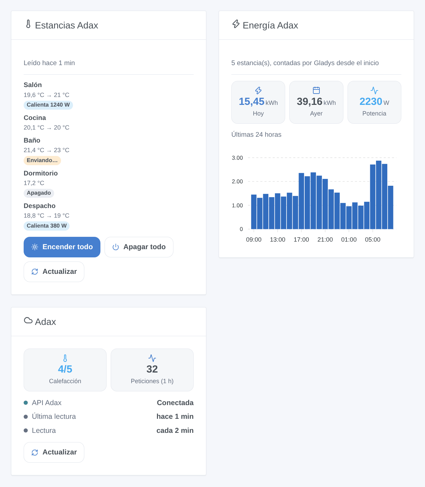

# Adax

## Presentación

Esta integración lleva sus radiadores **Adax WiFi** a Gladys. Usa la **API oficial de Adax** (la «Remote user client API» de la app Adax WiFi), con su id de cuenta y una credencial que usted crea en la app.

- Un dispositivo de Gladys por **estancia** de la app Adax: consigna, calefacción encendida o apagada, temperatura ambiente y, cuando sus radiadores la informan, si calientan, la potencia y un índice de energía para el panel de energía de Gladys.
- Disparadores de escena (calefacción encendida o apagada, consigna cambiada en la app Adax o en el radiador) y acciones de escena (consigna de una estancia o de todas, calefacción encendida o apagada, lectura inmediata).
- Tres widgets del panel: las estancias, con los botones «Encender todo» y «Apagar todo», la energía de hoy y de las últimas 24 horas, y la conexión.

**Transporte: nube.** Gladys nunca habla directamente con sus radiadores: lee y escribe en la nube de Adax, que transmite los cambios a los radiadores. Adax acepta **una petición cada 30 segundos**: un cambio hecho en Gladys se muestra al instante y llega al radiador **en 30 segundos como máximo**; un cambio hecho en la app Adax o en el radiador llega a Gladys en la siguiente lectura. Los datos de sus radiadores salen de su casa (ya lo hacen con la app Adax).

Sin relación con Adax. Aún no probada con una cuenta Adax real: cuéntenos qué funciona y qué no.

## Requisitos previos

- Gladys Assistant **5.3.0** o posterior.
- Radiadores Adax **WiFi** configurados en la **app Adax WiFi** (versión 3.7 o posterior), cada uno asignado a una **estancia**: la API ajusta la temperatura de las estancias, no la de un radiador suelto.
- En la app, pestaña **Cuenta** → **Remote user client API**: anote el **id de cuenta** que aparece, toque **Add credential**, dele un nombre (por ejemplo «Gladys») y copie la **contraseña generada**. Puede borrar esta credencial en cualquier momento para retirar el acceso de Gladys.

## Configuración

En Gladys, abra **Integraciones → Adax**:

| Campo                                    | Descripción                                                                                     |
| ---------------------------------------- | ----------------------------------------------------------------------------------------------- |
| Id de cuenta                             | El número que muestra la app Adax WiFi, Cuenta → Remote user client API.                        |
| Contraseña de la credencial              | La contraseña de la credencial: solo se envía a Adax, nunca se vuelve a mostrar ni se registra. |
| Intervalo de lectura                     | Cada 1, 2, 5 o 10 minutos (2 por defecto). Una petición lee todas las estancias.                |
| Idioma de los textos de los dispositivos | Nombres de las funciones y mensajes del botón; automático por defecto.                          |

Pulse **Probar la conexión**: la integración lee sus estancias y las lista con sus radiadores y funciones. Después abra la pestaña **Descubrir** y añada las estancias que quiera: no se crea nada sin usted. Con varias casas en la app, la casa se añade al nombre de la estancia.

## Uso

### Dispositivos

Cada estancia ofrece estas funciones:

| Función              | Tipo de Gladys                                 | Notas                                                                                                                               |
| -------------------- | ---------------------------------------------- | ----------------------------------------------------------------------------------------------------------------------------------- |
| Consigna             | Consigna de termostato, 5 a 35 °C de 1 en 1 °C | Adax ignora una consigna con la calefacción apagada: cambiar la consigna enciende la calefacción de la estancia.                    |
| Calefacción          | Modo del termostato: apagado o calefacción     | Apagado detiene los radiadores de la estancia; calefacción restablece la consigna (20 °C si Adax no da ninguna).                    |
| Temperatura ambiente | Sensor de temperatura                          | Medida por los radiadores.                                                                                                          |
| Calentando           | Estado de funcionamiento: reposo o calentando  | Si los radiadores consumieron desde la lectura anterior. Solo si los radiadores informan de su energía.                             |
| Potencia             | Potencia (W)                                   | La potencia media de la estancia desde la lectura anterior.                                                                         |
| Energía              | Índice de energía (kWh)                        | Contado por la integración a partir de la energía de cada hora que informa Adax; alimenta las páginas de consumo y coste de Gladys. |

El widget **Termostato** del panel de Gladys funciona con la consigna. El índice de energía empieza en 0 en la primera lectura de una estancia: Gladys solo usa sus aumentos. Con una lectura cada 2 minutos puede faltar un pequeño porcentaje de cada hora (la energía entre la última lectura de una hora y su final); un intervalo más corto pierde menos.

### Widgets del panel

- **Estancias Adax**: cada estancia con su temperatura y su consigna, una insignia (apagada, calentando con su potencia, orden enviándose). Toque una estancia para ver sus detalles (casa, radiadores, índice de energía). **Encender todo** y **Apagar todo** actúan sobre las estancias del widget, en una sola petición, tras una confirmación; **Actualizar** lee al instante. Elija las estancias en los ajustes del widget (8 como máximo).
- **Energía Adax**: la energía de hoy y de ayer, la potencia actual y un gráfico de barras de las últimas 24 horas, para todas las estancias o las elegidas en los ajustes.
- **Adax**: el estado de la conexión a la API, las estancias con calefacción, las peticiones de la última hora, un botón **Actualizar**.

### Escenas

Disparadores (cada uno puede limitarse a una estancia):

- **Se enciende la calefacción de una estancia** / **se apaga**: en la app Adax WiFi o en el radiador, nunca por la propia Gladys.
- **Cambia la consigna de una estancia**: en la app, en el radiador o por su programa semanal. La consigna anterior es una variable del disparador.

Acciones:

- **Ajustar la consigna de las estancias**: una estancia o todas, de 5 a 35 °C; enciende la calefacción (salidas: cambiadas, rechazadas, consigna escrita).
- **Encender o apagar la calefacción**: una estancia o todas (salidas: cambiadas, rechazadas).
- **Leer las estancias Adax ahora**: devuelve las estancias, las estancias con calefacción y la energía de hoy.

Ejemplos:

- Cuando todos salen de casa → ajustar la consigna de todas las estancias a 16 °C; cuando alguien vuelve → 21 °C.
- Cuando el precio de la electricidad de la hora es alto → apagar la calefacción de los dormitorios durante una hora y volver a encenderla.
- Cuando cambia la consigna de una estancia en la app Adax → enviar una notificación «{{triggerEvent.data.device_name}}: {{triggerEvent.data.target_temperature}} °C».

### Transporte

El catálogo muestra la insignia **nube**: cada petición va a `api-1.adax.no`, con su credencial. Esta integración no usa el modo local de los radiadores más recientes (necesita un emparejamiento Bluetooth que un contenedor no puede hacer).

## Solución de problemas

- **«Adax rechaza las credenciales»**: compruebe el id de cuenta y cree una credencial nueva en la app si la borró o no está seguro de su contraseña.
- **Conectada, pero ninguna estancia**: asigne sus radiadores a estancias en la app Adax WiFi.
- **«Adax pide reducir el ritmo»**: la API respondió «límite de peticiones superado» (402). La integración espacia sus lecturas y vuelve sola al ritmo normal. No use la misma credencial en varios programas a la vez.
- **Ni potencia ni energía**: sus radiadores no informan de su energía a la nube de Adax; la consigna, la calefacción y la temperatura siguen funcionando.
- **Una orden tarda hasta 30 segundos**: Adax acepta una petición cada 30 segundos; la insignia «Enviando…» muestra una orden en espera.
- Informe de un problema en [GitHub](https://github.com/William-De71/gladys-adax/issues) con su versión de Gladys, la versión de la integración y el resultado de «Probar la conexión».
