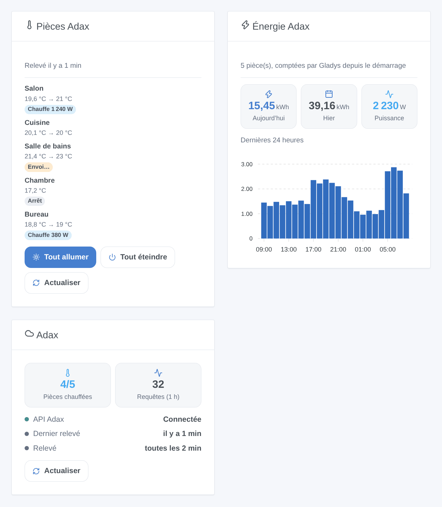

# Adax

## Présentation

Cette intégration amène vos radiateurs **Adax WiFi** dans Gladys. Elle utilise l’**API officielle d’Adax** (la « Remote user client API » de l’application Adax WiFi), avec votre identifiant de compte et un accès que vous créez dans l’application.

- Un appareil Gladys par **pièce** de l’application Adax : consigne, chauffage allumé ou éteint, température ambiante et, quand vos radiateurs la remontent, la chauffe en cours, la puissance et un index d’énergie pour le tableau de bord énergie de Gladys.
- Des déclencheurs de scène (chauffage allumé ou éteint, consigne changée dans l’application Adax ou sur le radiateur) et des actions de scène (consigne d’une pièce ou de toutes, chauffage allumé ou éteint, relevé immédiat).
- Trois widgets de tableau de bord : les pièces, avec les boutons « Tout allumer » et « Tout éteindre », l’énergie du jour et des dernières 24 heures, et la connexion.

**Transport : cloud.** Gladys ne parle jamais directement à vos radiateurs : elle lit et écrit dans le cloud Adax, qui relaie les changements aux radiateurs. Adax accepte **une requête toutes les 30 secondes** : un changement fait dans Gladys s’affiche tout de suite et atteint le radiateur **en 30 secondes au plus** ; un changement fait dans l’application Adax ou sur le radiateur atteint Gladys au relevé suivant. Les données de vos radiateurs quittent votre domicile (c’est déjà le cas avec l’application Adax).

Sans lien avec Adax. Pas encore testée avec un vrai compte Adax : dites-nous ce qui marche et ce qui ne marche pas.

## Prérequis

- Gladys Assistant **5.3.0** ou plus récent.
- Des radiateurs Adax **WiFi** installés dans l’**application Adax WiFi** (version 3.7 ou plus), chacun rangé dans une **pièce** : l’API règle la température des pièces, pas celle d’un radiateur seul.
- Dans l’application, onglet **Compte** → **Remote user client API** : notez l’**identifiant de compte** affiché, puis touchez **Add credential**, donnez un nom (par exemple « Gladys ») et copiez le **mot de passe généré**. Vous pouvez supprimer cet accès à tout moment pour retirer l’accès de Gladys.

## Configuration

Dans Gladys, ouvrez **Intégrations → Adax** :

| Champ                           | Description                                                                            |
| ------------------------------- | -------------------------------------------------------------------------------------- |
| Identifiant de compte           | Le numéro affiché dans l’application Adax WiFi, Compte → Remote user client API.       |
| Mot de passe de l’accès         | Le mot de passe de l’accès : envoyé à Adax uniquement, jamais réaffiché ni journalisé. |
| Intervalle de relevé            | Toutes les 1, 2, 5 ou 10 minutes (2 par défaut). Une requête relève toutes les pièces. |
| Langue des textes des appareils | Noms des fonctionnalités et messages du bouton ; automatique par défaut.               |

Cliquez sur **Tester la connexion** : l’intégration relève vos pièces et les liste avec leurs radiateurs et fonctionnalités. Ouvrez ensuite l’onglet **Découverte** et ajoutez les pièces voulues : rien n’est créé sans vous. Avec plusieurs maisons dans l’application, la maison est ajoutée au nom de la pièce.

## Utilisation

### Appareils

Chaque pièce propose ces fonctionnalités :

| Fonctionnalité       | Type Gladys                                | Remarques                                                                                                                             |
| -------------------- | ------------------------------------------ | ------------------------------------------------------------------------------------------------------------------------------------- |
| Consigne             | Consigne de thermostat, 5 à 35 °C par 1 °C | Adax ignore une consigne quand le chauffage est éteint : changer la consigne allume le chauffage de la pièce.                         |
| Chauffage            | Mode du thermostat : arrêt ou chauffage    | Arrêt coupe les radiateurs de la pièce ; chauffage remet la consigne (20 °C si Adax n’en donne pas).                                  |
| Température ambiante | Capteur de température                     | Mesurée par les radiateurs.                                                                                                           |
| Chauffe              | État de fonctionnement : repos ou chauffe  | Les radiateurs ont-ils consommé depuis le relevé précédent. Seulement si les radiateurs remontent leur énergie.                       |
| Puissance            | Puissance (W)                              | La puissance moyenne de la pièce depuis le relevé précédent.                                                                          |
| Énergie              | Index d’énergie (kWh)                      | Compté par l’intégration à partir de l’énergie de chaque heure remontée par Adax ; alimente les pages consommation et coût de Gladys. |

Le widget **Thermostat** du tableau de bord de Gladys fonctionne avec la consigne. L’index d’énergie part de 0 au premier relevé d’une pièce : Gladys n’utilise que ses hausses. Quelques pour cent de chaque heure peuvent manquer avec un relevé toutes les 2 minutes (l’énergie entre le dernier relevé d’une heure et sa fin) ; un intervalle plus court en perd moins.

### Widgets du tableau de bord

- **Pièces Adax** : chaque pièce avec sa température et sa consigne, un badge (arrêt, chauffe avec sa puissance, commande en cours d’envoi). Touchez une pièce pour ses détails (maison, radiateurs, index d’énergie). **Tout allumer** et **Tout éteindre** agissent sur les pièces du widget, en une requête, après confirmation ; **Actualiser** relève tout de suite. Choisissez les pièces dans les réglages du widget (8 au plus).
- **Énergie Adax** : l’énergie d’aujourd’hui et d’hier, la puissance actuelle et un histogramme des dernières 24 heures, pour toutes les pièces ou celles choisies dans les réglages.
- **Adax** : l’état de la connexion à l’API, les pièces en chauffe, les requêtes de la dernière heure, un bouton **Actualiser**.

### Scènes

Déclencheurs (chacun peut être limité à une pièce) :

- **Le chauffage d’une pièce est allumé** / **est éteint** : dans l’application Adax WiFi ou sur le radiateur, jamais par Gladys elle-même.
- **La consigne d’une pièce change** : dans l’application, sur le radiateur ou par son programme hebdomadaire. La consigne précédente est une variable du déclencheur.

Actions :

- **Régler la consigne des pièces** : une pièce ou toutes, de 5 à 35 °C ; allume le chauffage (sorties : pièces changées, refusées, consigne écrite).
- **Allumer ou éteindre le chauffage** : une pièce ou toutes (sorties : changées, refusées).
- **Relever les pièces Adax maintenant** : renvoie les pièces, les pièces en chauffe et l’énergie du jour.

Exemples :

- Quand tout le monde quitte la maison → régler la consigne de toutes les pièces à 16 °C ; au retour de quelqu’un → 21 °C.
- Quand le prix de l’électricité de l’heure est élevé → éteindre le chauffage des chambres pendant une heure, puis le rallumer.
- Quand la consigne d’une pièce change dans l’application Adax → envoyer une notification « {{triggerEvent.data.device_name}} : {{triggerEvent.data.target_temperature}} °C ».

### Transport

Le catalogue affiche le badge **cloud** : chaque requête part vers `api-1.adax.no`, avec votre accès. Cette intégration n’utilise pas le mode local des radiateurs les plus récents (il demande un appairage Bluetooth qu’un conteneur ne peut pas faire).

## Dépannage

- **« Adax refuse les identifiants »** : vérifiez l’identifiant de compte, et créez un nouvel accès dans l’application si vous l’avez supprimé ou si vous n’êtes pas sûr de son mot de passe.
- **Connectée, mais aucune pièce** : rangez vos radiateurs dans des pièces dans l’application Adax WiFi.
- **« Adax demande de ralentir »** : l’API a répondu « limite de requêtes dépassée » (402). L’intégration espace ses relevés, puis revient d’elle-même au rythme normal. N’utilisez pas le même accès dans plusieurs programmes à la fois.
- **Ni puissance ni énergie** : vos radiateurs ne remontent pas leur énergie au cloud Adax ; la consigne, le chauffage et la température fonctionnent quand même.
- **Une commande met jusqu’à 30 secondes** : Adax accepte une requête toutes les 30 secondes ; le badge « Envoi… » montre une commande en attente.
- Signalez un problème sur [GitHub](https://github.com/William-De71/gladys-adax/issues) avec votre version de Gladys, la version de l’intégration et le résultat de « Tester la connexion ».
